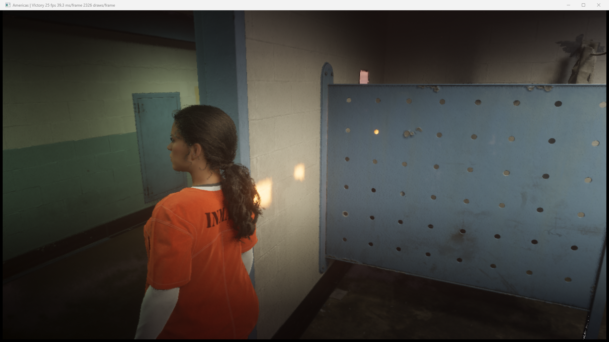
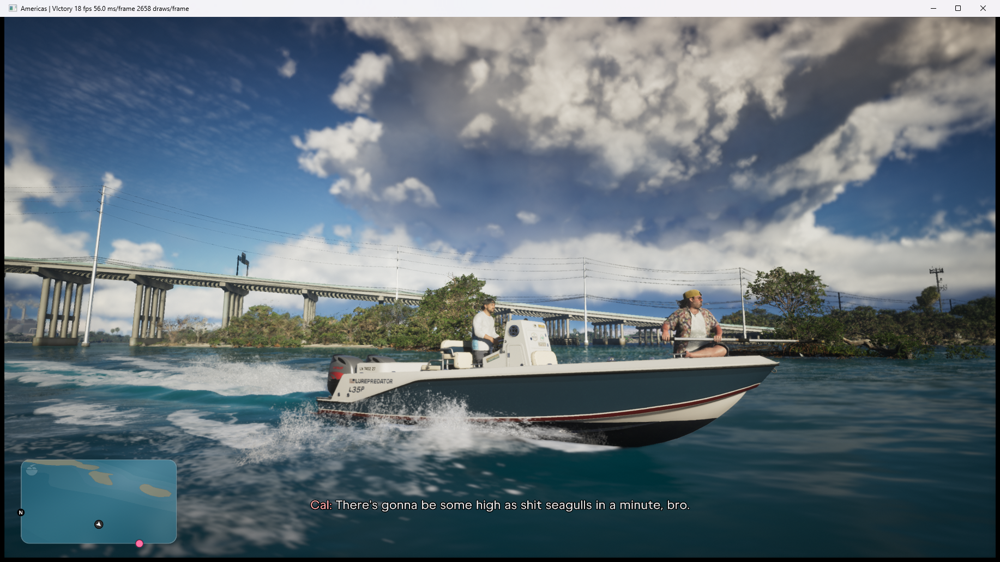

[**Türkçe**](README.md) | English

# VIctory RDNA4 — RX 9070 XT build (unofficial)

A source-only fork of [VIctory](https://github.com/Marvisak/VIctory) for **AMD RDNA4 (RX 9070 XT)** on Windows. It runs an Xbox Series X|S title natively on the PC from files **you supply**; it contains no game files, assets, keys or executables.

> **Not affiliated with Rockstar Games or Take-Two Interactive.** This is interoperability/research code. You must own a legally obtained copy of the game. No game files are hosted or linked here. Similar projects have received DMCA takedowns; publishing this source carries that risk.

## Transparency: AI-assisted build

This fork, its merge, the test harness and this README were prepared with an **AI coding agent** (OpenCode, model **DeepSeek V4.1 Flash**) under the direction of the human maintainer. The upstream VIctory / victory-fork / avatarmanz / Belobug / RYUKI code is **human-authored** and remains credited below. The AI proposed and applied changes, ran measurements on the maintainer's PC and drafted this document; the maintainer supplied the game files, made the publishing decision and reviewed the result. AI-assisted work can contain mistakes — reproduce the measurements before relying on them.

## Repository contents

**Source only.** This repository contains Rust crates, launchers, docs and two illustrative screenshots. It contains **no game files, no game assets, no executables, no keys, no caches and no saves**. The screenshots are captures of the running title; game imagery, characters and trademarks belong to their respective owners.

## Test PC

| Component | |
|---|---|
| GPU | AMD Radeon RX 9070 XT 16 GB (RDNA4), driver 32.0.32029.2010, Resizable BAR on |
| CPU | AMD Ryzen 7 7800X3D (8 cores / 16 threads) |
| RAM | 31 GB usable DDR5 |
| Storage | Samsung 990 PRO NVMe |
| OS | Windows 11, build 26300 |
| Page file | 48 GB fixed on C: |
| Display | 1920×1080 |

## Screenshots

| Lucia, prison corridor — 25 fps | Boat scene, Series X — 18 fps |
|---|---|
|  |  |

Both are captures from this build line; frame counters are in the window title. Game imagery and trademarks belong to their owners.

## Status (27 November 2026)

| | |
|---|---|
| Stage | **In-game** (open world, missions, saves) |
| Test PC | RX 9070 XT 16 GB, Ryzen 7 7800X3D, 31 GB RAM, 48 GB page file, Windows 11, driver 32.0.32029.2010 |
| Series X, 5.8–6.2k draws | **19–20 fps** (~50–53 ms) |
| Series X, 6–9k draws | **18.5 fps** median |
| Series X, 8–12k draws | **16.8 fps** median |
| Series X, dense 9.2k | ~14 fps |
| Series S (warm cache) | **27.1 fps** median, 30.5 peak |
| Pipeline warm | **83,552 pipelines / 377 s**, **4 failed** (baseline had 70) |
| Not yet | stable 30 fps, verified 30-minute session, all visual gaps |

This is **not 30 fps everywhere**. It is a tuned build for one AMD RDNA4 card; expect differences on other GPUs.

## What this tree adds

- **Belobug's VEH compiler guard** (`81ebb7b`): an AMD driver compiler crash (`amdxc64+0x861b9f`) is isolated per pipeline instead of ending the run.
- **Belobug PR #324** (`4363233` here): do not reuse `dx.op.getDimensions` in the REUSE pass. AMD's RDNA4 compiler crashed on 29 `CS_RaytracingResolve` compute pipelines; the warm bad count fell from **70 to 4**.
- **Renderer port 7** (`VICTORY_PORT_JOURNAL`, avatarmanz `c9c932c`): the heaps' records are split into 64 locked parts; submit-thread waits ~5 ms + 1 ms → ~0.3 ms.
- **RYUKI-7900XT settings** (YukiRyuu): `WINDOW_KB=1024`, `INPLACE=1`, `TEXTURE_STAGE_MS=80`, `CARD_BUFFERS_MIN_MB=1`, `CARD_BUFFERS_MB=1536`, `ASK_EARLY=2`, `HEAP_SYNC_EARLY=1`, `JOIN_PARTS=16`, `JOIN_LISTS=96`, `TITLE_PRIORITIES=1`, `THIN_THREADS=4`, `UNDER_THREADS=3`, `LAND_THREADS=3`, `FILL_TITLE=1`. On the 7800X3D this cut preparing to ~25 ms in the 6–9k draw range.
- **cool_fox / CGBJ base** and **fxceless/victory-fork** lineage.

## Upstream check (27 November 2026)

This tree is a manual port of #324 onto the port-7 base (`c9c932c`). Upstream moved after publication:

| Repo | Commit | Not in this tree |
|---|---|---|
| **Belobug / a-publier** | `4eb6cfd` | RX 9070 XT fixes + HUD, texture upload prelude, port 2 sync, FSR4K (52 commits ahead) |
| avatarmanz / main | `014d52d` | `VICTORY_PORT_CONSTANTS_ORDER` (tree/palm pop-in, lamp-room flicker), port RT |
| fxceless / main | `9a9091d` | RT builder (0.2–3 fps, unusable for play), #1320/#1321/#1324/#1336 |

Details: [`docs/UPSTREAM-CHECK.md`](docs/UPSTREAM-CHECK.md).

**Short test:** Belobug a-publier's HUD and textures rendered correctly; FPS ranged 11–20 depending on the scene, and it was not compared with #324 in the same scene. The published default remains **#324**; a-publier is a candidate. Next: merge `PORT_CONSTANTS_ORDER` and A/B on a fixed save.

## Build

```powershell
git clone <this repository>
cd <this repository>
copy victory.example.toml victory.toml   # set game_dir, cache_dir, data_dir
cargo build --profile diag -p victory --features diagnostics
```

Diagnostics are needed for the frame lines and `VICTORY_KEYS` menu automation. A release build is faster per frame but has no diagnostics.

### Translate shaders and warm pipelines

```powershell
$env:VICTORY_CACHE_DIR = "$env:LOCALAPPDATA\victory\cache"
.\target\diag\victory.exe shaders "<path>\shaders.rpf"
.\target\diag\victory.exe warm --jobs 8
```

Warm reads `known-pipelines.bin` written by a run with `VICTORY_PIPELINE_BOOK=1`:

```powershell
$env:VICTORY_PIPELINE_BOOK = "1"
.\target\diag\victory.exe run --console series-x "<path>\game_scarlett_master.exe" --execute
# play a few minutes, close, then:
.\target\diag\victory.exe warm --jobs 8
```

### Play

```powershell
.\target\diag\victory.exe run --console series-x "<path>\game_scarlett_master.exe" --execute
```

## Settings used for the results

```text
VICTORY_RELAY=2
VICTORY_WIDE_BACK=1
VICTORY_TEXTURE_NO_WAIT=1
VICTORY_CARD_REHASH_RUNS=1
VICTORY_JOIN_COPIES=1
VICTORY_INDIRECT_WINDOW=1
VICTORY_RELAY_COPY=1
VICTORY_CARD_STEPS=2
VICTORY_INDIRECT_BATCH=2
VICTORY_MAP_THREADS=1
VICTORY_CARD_AWAKE=1
VICTORY_SHOW_AFTER=1
VICTORY_D3D12_DRED=light
VICTORY_THIN=1
VICTORY_UPLOAD_AHEAD=1
VICTORY_PORT_CONSTANTS=1
VICTORY_PORT_DESCRIPTORS=1
VICTORY_PORT_CBV=1
VICTORY_PORT_GUARD=1
VICTORY_PORT_JOURNAL=1
VICTORY_WINDOW_KB=1024
VICTORY_INPLACE=1
VICTORY_INPLACE_MB=3072
VICTORY_TEXTURE_STAGE_MS=80
VICTORY_CARD_BUFFERS_MIN_MB=1
VICTORY_CARD_BUFFERS_MB=1536
VICTORY_ASK_EARLY=2
VICTORY_HEAP_SYNC_EARLY=1
VICTORY_JOIN_PARTS=16
VICTORY_JOIN_LISTS=96
VICTORY_TITLE_PRIORITIES=1
VICTORY_THIN_THREADS=4
VICTORY_UNDER_THREADS=3
VICTORY_LAND_THREADS=3
VICTORY_FILL_TITLE=1
VICTORY_AMBIENT=0.8
VICTORY_SKIP_MOVIES=1
```

Optional:
- `VICTORY_OUTPUT=1920x1080` — **21 fps** vs 20 at ~5.8k draws in our test; small gain, softer image.
- `VICTORY_PORT_CONSTANTS=0` — Mavis reports the sky flickers with port 1 on this card; disabling it may cost a little speed.
- `VICTORY_TEXTURE_LOOK_MS=500`, `VICTORY_TEXTURE_AWAY_MS=15000` — Mavis's texture queue tuning.

## What did not help (on this PC)

| Change | Result |
|---|---|
| Xavi `4c210de` place_copy | 8.8 fps at 7–9k (baseline 18.5) |
| cool_fox `5e0c9ab` Port 1 page order | 15.1 / 10.6 at 7–13k |
| fxceless `a463dcb` texture alias pin | 12.1 / 14.0 |
| All three together | 12.1 / 14.0 |
| Full A-settings set (SHADER_OPT=59, levels-on-demand, copies-in-place=0, texture store, 1080p…) | 1 fps / 1.28 s — unusable |
| `WARM_BAD=0` warm retry | 0 of 70 recovered |
| Belobug FSR 4K quality | 3–4 fps, broken face |
| Series S + 1440p | crash `0x80000003` |

### Additional setting tests (27 November)

| Setting | FPS | Draw | Note |
|---|---:|---:|---|
| Port 1 off | 18 | 7,577 | 7–9k baseline 18.5; no gain |
| Port 1 off + 1080p | 20 | 5,666 | 1080p alone 21; no extra gain |
| Port 1 off + 1080p + texture look/away | 18 | 5,770 | min 11; worse |
| Texture look/away | 15 | 10,057 | heavy scene; not comparable |

**Result:** On this PC, 1080p alone is the only small gain (+1 fps); port 1 off and texture look/away did not help. The default #324 build was kept.

## Known issues

- **4 pipelines still crash** the AMD compiler and are skipped: `0629334f…`, `258bc42c…`, `def4b5eb…`, `e55232ff…`.
- Some draws may still be missing; a transparent car / missing body parts has been reported on related builds. Not fully verified after #324.
- Opening screen can flicker with `WINDOW_KB=1024`; RYUKI's `ROOT_WINDOW_MB` fix is not in this tree.
- Textures arrive late; no ray-traced indirect light (`AMBIENT=0.8` stand-in).
- 31 GB RAM is tight (30+ GB commit); close Chrome/Discord. 48 GB page file recommended.
- 30-minute stability not yet verified by us.
- The title's 30 fps cap remains; menus/cutscenes are 30.

## Credits

This is a tree of other people's work. All upstream history and authors are kept.

- **Marvisak / VIctory** — loader, HLE runtime, D3D12 backend, shader recompiler.
- **fxceless / victory-fork** — AMD fixes, base of this line.
- **avatarmanz / VIctory-7900XTX** — renderer ports 1/2/5/6/7, RDNA3 tuning.
- **Belobug / VIctory-Belobug-AMD** — VEH compiler guard, RDNA4 compiler fix (#324), magenta/VRAM fixes.
- **YukiRyuu / RYUKI-7900XT** — RX 7900 XT settings and findings used as the starting preset.
- **codec-d / cool_fox (CGBJ)** and the cool_fox mirrors — the original tuned tree.
- **DexNom, myokex, ka1qux, ScarlettPort, klbf-lab** and the wider community — fixes and measurements.

## License

GPL-3.0-or-later, following VIctory. Include the upstream `LICENSE` and keep copyright notices. No game files, no assets, no keys.
