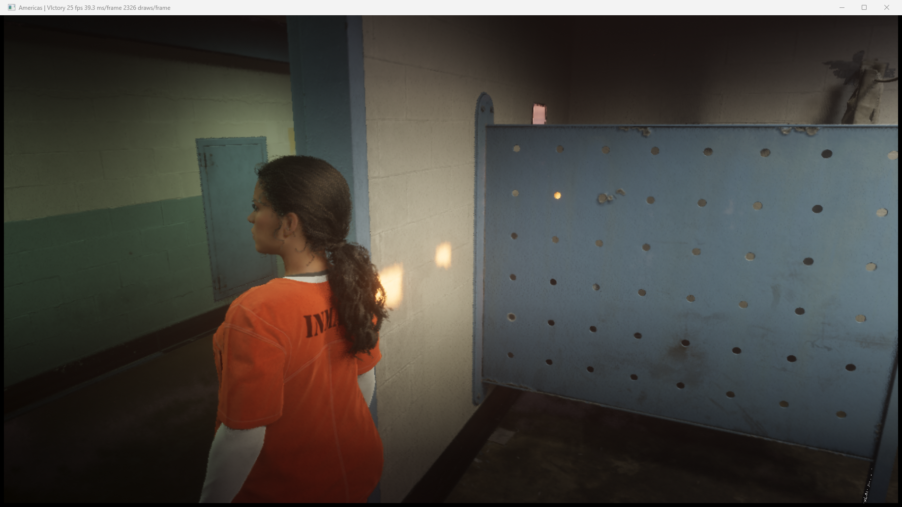
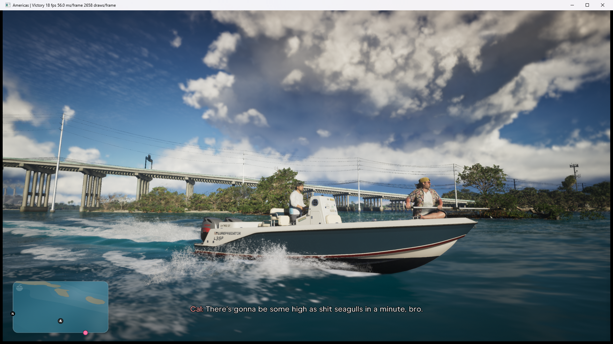

# VIctory RDNA4 — RX 9070 XT build (resmî olmayan)

[English](README.en.md) | **Türkçe**

AMD RDNA4 (RX 9070 XT) için Windows üzerinde, [VIctory](https://github.com/Marvisak/VIctory) tabanlı **kaynak-only** bir fork. Xbox Series X|S oyununu, **sizin sağladığınız dosyalarla** PC'de natively çalıştırır; bu repoda oyun dosyası, asset, key veya çalıştırılabilir dosya yoktur.

> **Rockstar Games veya Take-Two Interactive ile bağlantılı değildir.** Bu, interoperability/research kodudur. Oyunun yasal olarak edinilmiş bir kopyasına sahip olmalısınız. Burada oyun dosyası barındırılmaz veya linklenmez. Benzer projeler DMCA aldı; bu kaynağı yayınlamak bu riski taşır.

## Şeffaflık: AI destekli build

Bu fork, merge, test harness'i ve bu README bir **AI kodlama ajanı** (OpenCode, model **DeepSeek V4.1 Flash**) tarafından, insan maintainer'ın yönlendirmesiyle hazırlandı. Üst kaynak kod (VIctory / victory-fork / avatarmanz / Belobug / RYUKI) **insan geliştiricilerin** ve aşağıda kredilendirilmiştir. AI değişiklikleri önerdi/uyguladı, maintainer'ın PC'sinde ölçümleri çalıştırdı ve bu dokümanı yazdı; maintainer oyun dosyalarını sağladı, yayın kararını verdi ve sonucu inceledi. AI destekli iş hata içerebilir — ölçümleri güvenmeden önce tekrar edin.

## Depo içeriği

**Sadece kaynak.** Bu repoda Rust crate'leri, launcher'lar, dokümanlar ve iki örnek ekran görüntüsü vardır. **Oyun dosyası, oyun asset'i, çalıştırılabilir dosya, key, cache veya save yoktur.** Görseller oyunun çalışan halinden alınmıştır; oyun görselleri, karakterler ve markalar sahiplerine aittir.

## Test PC

| Bileşen | |
|---|---|
| GPU | AMD Radeon RX 9070 XT 16 GB (RDNA4), sürücü 32.0.32029.2010, Resizable BAR açık |
| CPU | AMD Ryzen 7 7800X3D (8 çekirdek / 16 iş parçacığı) |
| RAM | 31 GB kullanılabilir DDR5 |
| Disk | Samsung 990 PRO NVMe |
| OS | Windows 11, build 26300 |
| Page file | C: üzerinde 48 GB sabit |
| Ekran | 1920×1080 |

## Ekran görüntüleri

| Lucia, hapishane koridoru — 25 fps | Tekne sahnesi, Series X — 18 fps |
|---|---|
|  |  |

İkisi de bu build hattından alınmıştır; fps sayaçları pencere başlığındadır. Oyun görselleri ve markalar sahiplerine aittir.

## Durum (27 Kasım 2026)

| | |
|---|---|
| Aşama | **In-game** (açık dünya, görevler, save'ler) |
| Series X, 5.8–6.2k draw | **19–20 fps** (~50–53 ms) |
| Series X, 6–9k draw | **18.5 fps** medyan |
| Series X, 8–12k draw | **16.8 fps** medyan |
| Series X, yoğun 9.2k | ~14 fps |
| Series S (warm cache) | **27.1 fps** medyan, 30.5 tepe |
| Pipeline warm | **83.552 pipeline / 377 s**, **4 başarısız** (baseline'da 70) |
| Henüz değil | stabil 30 fps, doğrulanmış 30 dakikalık oturum, tüm görsel boşluklar |

Bu **her yerde 30 fps değildir**. Tek bir AMD RDNA4 kartı için ayarlanmış bir build'dir; diğer GPU'larda farklılık beklenir.

## Bu ağacın ekledikleri

- **Belobug VEH compiler guard** (`81ebb7b`): AMD sürücü derleyici çökmesi (`amdxc64+0x861b9f`) pipeline başına izole edilir; tüm oturum ölmez.
- **Belobug PR #324** (burada `4363233`): REUSE pass'inde `dx.op.getDimensions` yeniden kullanılmaz. AMD'nin RDNA4 derleyicisi 29 `CS_RaytracingResolve` compute pipeline'ında çöküyordu; warm bad sayısı **70 → 4**'e düştü.
- **Renderer port 7** (`VICTORY_PORT_JOURNAL`, avatarmanz `c9c932c`): heap kayıtları 64 kilitli parçaya bölünür; submit thread beklemeleri ~5 ms + 1 ms → ~0.3 ms.
- **RYUKI-7900XT ayarları** (YukiRyuu): `WINDOW_KB=1024`, `INPLACE=1`, `TEXTURE_STAGE_MS=80`, `CARD_BUFFERS_MIN_MB=1`, `CARD_BUFFERS_MB=1536`, `ASK_EARLY=2`, `HEAP_SYNC_EARLY=1`, `JOIN_PARTS=16`, `JOIN_LISTS=96`, `TITLE_PRIORITIES=1`, `THIN_THREADS=4`, `UNDER_THREADS=3`, `LAND_THREADS=3`, `FILL_TITLE=1`. 7800X3D'de 6–9k draw aralığında preparing ~25 ms'e indi.
- **cool_fox / CGBJ tabanı** ve **fxceless/victory-fork** hattı.

## Upstream kontrolü (27 Kasım 2026)

Bu ağaç, #324'ün port-7 tabanına (`c9c932c`) manuel portudur. Yayından sonra upstream ilerledi:

| Repo | Commit | Bizde olmayan |
|---|---|---|
| **Belobug / a-publier** | `4eb6cfd` | RX 9070 XT fix + HUD, texture upload prelude, port 2 sync, FSR4K (52 commit ileri) |
| avatarmanz / main | `014d52d` | `VICTORY_PORT_CONSTANTS_ORDER` (ağaç/avize pop-in, lamba odası flicker), port RT |
| fxceless / main | `9a9091d` | RT builder (0.2–3 fps, oyun için kullanılamaz), #1320/#1321/#1324/#1336 |

Ayrıntı: [`docs/UPSTREAM-CHECK.md`](docs/UPSTREAM-CHECK.md).

**Kısa test:** Belobug a-publier'de HUD ve dokular sağlam göründü; FPS sahneye göre 11–20 arasında değişti, #324 ile aynı sahnede doğrudan kıyas yapılmadı. Yayınlanan varsayılan **#324**; a-publier aday. Sonraki adım: a-publier + `PORT_CONSTANTS_ORDER` birleştirip sabit save'de A/B yapmak.

## Derleme

```powershell
git clone <bu repo>
cd <bu repo>
copy victory.example.toml victory.toml   # game_dir, cache_dir, data_dir ayarla
cargo build --profile diag -p victory --features diagnostics
```

Frame satırları ve `VICTORY_KEYS` menü otomasyonu için diagnostics gerekir. Release build kare başına daha hızlıdır ama diagnostics içermez.

### Shader çevirisi ve pipeline warm

```powershell
$env:VICTORY_CACHE_DIR = "$env:LOCALAPPDATA\victory\cache"
.\target\diag\victory.exe shaders "<yol>\shaders.rpf"
.\target\diag\victory.exe warm --jobs 8
```

Warm, `VICTORY_PIPELINE_BOOK=1` ile yapılan bir run'ın yazdığı `known-pipelines.bin` dosyasını okur:

```powershell
$env:VICTORY_PIPELINE_BOOK = "1"
.\target\diag\victory.exe run --console series-x "<yol>\game_scarlett_master.exe" --execute
# birkaç dakika oyna, kapat, sonra:
.\target\diag\victory.exe warm --jobs 8
```

### Oynatma

```powershell
.\target\diag\victory.exe run --console series-x "<yol>\game_scarlett_master.exe" --execute
```

## Sonuçlar için kullanılan ayarlar

```text
VICTORY_RELAY=2
VICTORY_WIDE_BACK=1
VICTORY_TEXTURE_NO_WAIT=1
VICTORY_CARD_REHASH_RUNS=1
VICTORY_JOIN_COPIES=1
VICTORY_INDIRECT_WINDOW=1
VICTORY_RELAY_COPY=1
VICTORY_CARD_STEPS=2
VICTORY_INDIRECT_BATCH=2
VICTORY_MAP_THREADS=1
VICTORY_CARD_AWAKE=1
VICTORY_SHOW_AFTER=1
VICTORY_D3D12_DRED=light
VICTORY_THIN=1
VICTORY_UPLOAD_AHEAD=1
VICTORY_PORT_CONSTANTS=1
VICTORY_PORT_DESCRIPTORS=1
VICTORY_PORT_CBV=1
VICTORY_PORT_GUARD=1
VICTORY_PORT_JOURNAL=1
VICTORY_WINDOW_KB=1024
VICTORY_INPLACE=1
VICTORY_INPLACE_MB=3072
VICTORY_TEXTURE_STAGE_MS=80
VICTORY_CARD_BUFFERS_MIN_MB=1
VICTORY_CARD_BUFFERS_MB=1536
VICTORY_ASK_EARLY=2
VICTORY_HEAP_SYNC_EARLY=1
VICTORY_JOIN_PARTS=16
VICTORY_JOIN_LISTS=96
VICTORY_TITLE_PRIORITIES=1
VICTORY_THIN_THREADS=4
VICTORY_UNDER_THREADS=3
VICTORY_LAND_THREADS=3
VICTORY_FILL_TITLE=1
VICTORY_AMBIENT=0.8
VICTORY_SKIP_MOVIES=1
```

İsteğe bağlı:
- `VICTORY_OUTPUT=1920x1080` — testte **21 fps** (20'ye karşı, ~5.8k draw); küçük kazanç, daha yumuşak görüntü.
- `VICTORY_PORT_CONSTANTS=0` — Mavis, bu kartta port 1 açıkken gökyüzünün flicker yaptığını bildiriyor; kapatmak biraz hız kaybettirebilir.
- `VICTORY_TEXTURE_LOOK_MS=500`, `VICTORY_TEXTURE_AWAY_MS=15000` — Mavis'in texture kuyruğu ayarı.

## Bu PC'de işe yaramayanlar

| Değişiklik | Sonuç |
|---|---|
| Xavi `4c210de` place_copy | 7–9k'da 8.8 fps (baseline 18.5) |
| cool_fox `5e0c9ab` Port 1 sayfa sırası | 7–13k'da 15.1 / 10.6 |
| fxceless `a463dcb` texture alias pin | 12.1 / 14.0 |
| Üçü birden | 12.1 / 14.0 |
| Tüm A-ayar seti (SHADER_OPT=59, levels-on-demand, copies-in-place=0, texture store, 1080p…) | 1 fps / 1.28 s — kullanılamaz |
| `WARM_BAD=0` warm retry | 70'in 0'ı kurtuldu |
| Belobug FSR 4K quality | 3–4 fps, bozuk yüz |
| Series S + 1440p | çökme `0x80000003` |

### Ek ayar denemeleri (27 Kasım)

| Ayar | FPS | Draw | Not |
|---|---:|---:|---|
| Port 1 kapalı | 18 | 7.577 | 7–9k baseline 18.5; kazanç yok |
| Port 1 kapalı + 1080p | 20 | 5.666 | 1080p tek başına 21; ek kazanç yok |
| Port 1 kapalı + 1080p + texture look/away | 18 | 5.770 | min 11; daha kötü |
| Texture look/away | 15 | 10.057 | ağır sahne; kıyas dışı |

**Sonuç:** Bu PC'de 1080p tek başına en iyi küçük fark (+1 fps); Port 1 kapatmak ve texture look/away net kazanç sağlamadı. Varsayılan #324 build'i korundu.

## Bilinen sorunlar

- **4 pipeline hâlâ AMD derleyicisinde çöküyor** ve atlanıyor: `0629334f…`, `258bc42c…`, `def4b5eb…`, `e55232ff…`.
- Bazı draw'lar hâlâ eksik olabilir; ilgili build'lerde yarı saydam araç / eksik gövde parçaları bildirildi. #324 sonrası tam doğrulanmadı.
- `WINDOW_KB=1024` ile açılış ekranı flicker yapabilir; RYUKI'nin `ROOT_WINDOW_MB` fix'i bu ağaçta yok.
- Dokular geç geliyor; ray-traced dolaylı ışık yok (`AMBIENT=0.8` stand-in).
- 31 GB RAM sınırda (30+ GB commit); Chrome/Discord kapatın. 48 GB page file önerilir.
- 30 dakikalık stabilite tarafımızdan henüz doğrulanmadı.
- Oyunun 30 fps kilidi sürüyor; menü/cutscene'ler 30.

## Krediler

Bu, başkalarının emeğinin üzerine kurulu bir ağaçtır. Tüm upstream geçmiş ve yazarlar korunmuştur.

- **Marvisak / VIctory** — loader, HLE runtime, D3D12 backend, shader recompiler.
- **fxceless / victory-fork** — AMD fix'leri, bu hattın tabanı.
- **avatarmanz / VIctory-7900XTX** — renderer port 1/2/5/6/7, RDNA3 tuning.
- **Belobug / VIctory-Belobug-AMD** — VEH compiler guard, RDNA4 compiler fix (#324), magenta/VRAM fix'leri.
- **YukiRyuu / RYUKI-7900XT** — RX 7900 XT ayarları ve bulguları; başlangıç preset'i.
- **codec-d / cool_fox (CGBJ)** ve cool_fox mirror'ları — orijinal tuned ağaç.
- **DexNom, myokex, ka1qux, ScarlettPort, klbf-lab** ve daha geniş topluluk — fix'ler ve ölçümler.

## Lisans

GPL-3.0-or-later, VIctory'yi takip eder. Upstream `LICENSE` dosyasını ve copyright notlarını koruyun. Oyun dosyası, asset, key yok.
